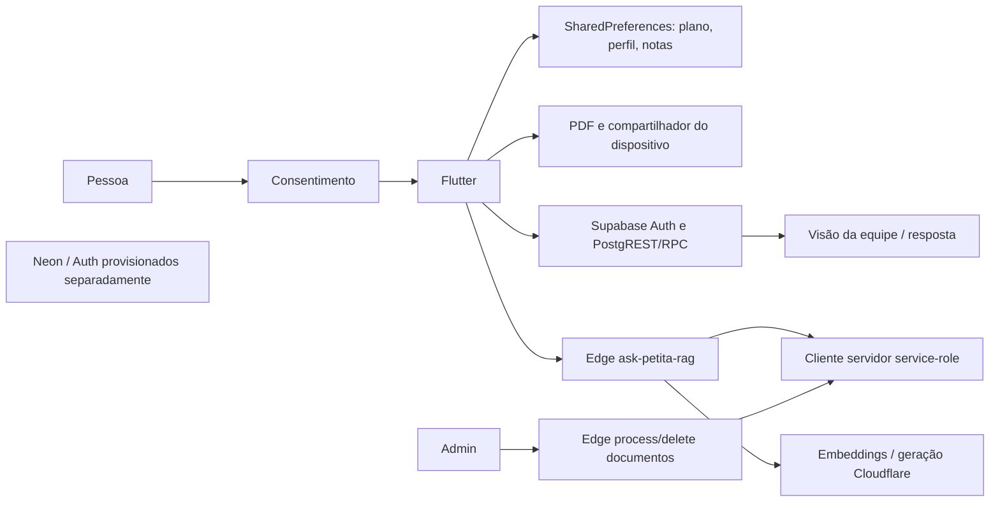

# Janela A — segurança e privacidade, 2026-11-06 UTC

Escopo: código disponível equivalente a main 5ec0a70 e documentos da branch fed565e. A comparação das PRs não foi repetida. Só fixtures sintéticas, mocks em memória e ferramentas Cloud. Não houve conexão a bancos/Auth/Cloudflare reais, publicação ou integração de PR.

## Fluxo de dados observado

Nenhuma seta Flutter→Neon está implementada nesta base. Credencial service-role é referência a variável do servidor, não chave encontrada no app. Código não prova estado das policies, buckets, roles ou infraestrutura implantada.

## Matriz técnica de dados e retenção

| Dado | Origem → destino | Controle observado | Retenção/exclusão e limite |
|---|---|---|---|
| Respostas do plano | usuária → birth_plan_answers | ciência inicial com cinco aceites; JSON em SharedPreferences | clearAnswers/revogação removem chave; escrita recusada pode parecer sucesso (SEC-05) |
| Nome/email/UBS/perfil | cadastro local/online → local_user_profile | ciência local; papel local não desbloqueou admin/equipe no teste sem sessão | clearProfile/revogação; logout online preserva modo local por desenho, não é isolamento de dados por conta |
| Pronome/DPP/preferências | usuária → storage local/PDF conforme opções | storage e consentimento existentes | clearAnswers/revogação; cifragem do app não demonstrada (SEC-04) |
| Perguntas adiadas/notas | consulta → chaves consultation_deferred/notes | permanecem locais; não viram resposta fictícia (teste existente) | clearAnswers/revogação; corrida SEC-06; falha de gravação SEC-05 |
| Dúvida UBS legada | API StorageService → ubs_questions | sem uso nas telas atuais encontrado por rg | revogação não remove chave (SEC-07); relevância em instalações antigas não medida |
| Ciência e versão/data | cinco aceites → consent_record_v2 | versão atual obrigatória; consentimento antigo/malformado recusado | revogação remove local; não equivale a exclusão remota |
| Sessão online | Supabase Auth → SDK/storage do provedor | código usa Supabase; Flutter não migrou para Neon/Google | JWT/refresh/revogação reais e resíduo de sessão após retirar ciência NÃO TESTADOS |
| Plano sincronizado | Flutter → birth_plans | exige currentUser no cliente; usa user.id como patient_id | RLS/identidade implantadas e exclusão remota NÃO VERIFICADAS |
| Dúvida online/ligação paciente | Flutter RPC → patient_questions/question_patient_links | servidor deve derivar dono; list_my usa auth.uid no SQL versionado | retenção/exclusão e RPCs efetivamente disponíveis NÃO VERIFICADOS |
| Fila UBS e respostas | visão/RPC → equipe | cliente usa select * sem filtro UBS; deve ser projeção segura no servidor | mocks A/B só documentam fronteira, não validam RLS |
| Texto RAG | conversa → Edge → Cloudflare | chave publicável; limite 3–1500; sem validação de usuário/quota no handler | provedor recebe texto; políticas de retenção externas NÃO VERIFICADAS |
| Logs RAG | handler → rag_query_logs | hash SHA-256, tamanho, categoria e fontes; não pergunta bruta no teste | sem expiração versionada identificada; hash sem segredo não garante anonimização |
| Documento educativo | admin → Storage → conversão/chunks | getUser + perfil; active exigido após SEC-01 | parser/bucket/limites reais não exercitados; remoção usa serviço privilegiado |
| PDF exportado | dispositivo → destino escolhido | dados sensíveis podem constar no artefato | exclusão de storage não recupera cópias exportadas; não foi exportado PDF nesta rodada |

SharedPreferences legível no teste comprova falta de cifragem na camada do aplicativo; não prova leitura por outro app, permissões do SO, estado de criptografia do disco nem backup de APK real. Exigir desenho de migração sem apagar dados antes de trocar storage.

## Cinco fluxos de abuso e evidências

| Fluxo | Resultado demonstrado | Limite / próximo gate |
|---|---|---|
| Administrador desativado mantém sessão e solicita remoção/processamento | Antes: 200/202 e cliente privilegiado; depois SEC-01: 403, zero efeito privilegiado | RLS pode ocultar perfil inativo na implantação; não testado. Corrigido somente fonte da branch. |
| Ator só conhece chave pública e repete RAG | 3 requisições sem Authorization acionam 3 embeddings; zero checagem de usuário; chave inválida não aciona provedor | WAF/quota externos não verificados. Gate B: política explícita e controle de consumo. |
| Editar perfil local para admin/equipe ou metadados do usuário | Perfil local sem sessão não abre áreas; metadados admin não sobrepõem perfil patient nos handlers | Testes não validam JWT real, grants nem políticas do servidor. |
| Equipe UBS A solicita fila/ID da UBS B ou gestante tenta histórico alheio | Cliente aceita fila mista se servidor a devolver; histórico próprio sem sessão recusado antes de HTTP | **Isolamento servidor NÃO VERIFICADO.** Não criar filtro visual como substituto de RLS/autorização. |
| Falha/disputa no storage ou retirada da ciência em instalação antiga | Dados legíveis; gravação false desaparece na recarga sem erro; duas marcações perdem uma; dúvida legada permanece | Fixtures reproduzem camada de serviço. Concorrência por gestos reais, disco/SO e dados legados efetivamente instalados não medidos. |

## Autorização e UBS: fronteira que permanece sem prova

- SupabaseService.listTeamQuestions (linhas 259–267) consulta team_questions_anonymous com select * e status pending. Um fake servidor devolvendo A+B chega como A+B ao serviço. Isso **não prova vazamento real** e adicionar eq(ubs_code) no cliente não protege uma API atacada diretamente.
- A definição dessa visão e os corpos de submit_patient_question/respond_to_patient_question não foram encontrados nos SQL de main. Esquema inicial é proposto; patches não formam snapshot completo de segurança. Não reconstruir um esquema imaginado e chamar seu teste de homologação do legado.
- list_my_patient_questions no patch v6 contém auth.uid e projeção limitada. public.is_admin no patch v5.3 verifica papel/active, mas não é chamado pelos handlers defeituosos. Existência/aplicação real e ACLs não consultadas.
- Relação profiles.id/auth_user_id versus user.id do Flutter exige catálogo/mapeamento de homologação; provisionar Neon separadamente não resolve essa divergência.
- Testes isolados necessários antes de liberar dados reais: login normal sem owner/BYPASSRLS para duas gestantes e equipes A/B; fila A sem B/identificadores; resposta a UUID de B recusada; histórico alheio recusado; SELECT direto das tabelas privadas recusado; autoelevação/alteração de ubs_code/papel recusada; admin sem conteúdo clínico; conta/unidade revogada recusada em nova transação e corrida controlada.
- Usar catálogo/migrations sanitizados autorizados ou futura convergência já documentada (#15/#17), sem tocar produção nem recriar as PRs. Nunca fornecer credencial SQL ao Flutter.

## Resultados e reprodução

Prefixo de cada comando: bash tool/run_bounded_audit.sh LABEL SEGUNDOS.
Flutter no Cloud requer permissão adicional de rede do sandbox para socket loopback; todos os clientes de aplicação nestes testes são falsos ou não inicializados.

| Label / comando após o prefixo | Prazo | Resultado / duração |
|---|---:|---|
| sdk / flutter --version | 20s | Flutter 3.44.0, Dart 3.12.0; 1s |
| storage-baseline-retry / flutter test --no-pub test/storage_service_test.dart test/storage_recovery_test.dart test/consent_gate_test.dart | 180s | 22 aprovados, 4s |
| edge-authorization-before / node --experimental-vm-modules --test-isolation=none --test --test-name-pattern='inactive admin' tool/test_edge_security.mjs | 60s | 2 falhas esperadas, 200/202 em vez de 403; <1s |
| edge-after / node --experimental-vm-modules --test-isolation=none --test tool/test_edge_security.mjs | 60s | 24 aprovados, 1s |
| storage-adversarial / flutter test --no-pub test/security_storage_audit_test.dart | 180s | 5 caracterizações aprovadas, 3s |
| auth-boundary-retry / flutter test --no-pub test/security_auth_boundary_test.dart | 180s | 5 testes aprovados, 5s |
| offline-consultation / flutter test --no-pub test/consultation_offline_test.dart test/faq_offline_test.dart | 180s | 5 aprovados, 5s |
| analyze-security-fixed / flutter analyze --no-pub test/security_storage_audit_test.dart test/security_auth_boundary_test.dart | 120s | sem apontamentos, 10s |

Total por escopo distinto: **37 Flutter + 24 Node = 61 verificações**, incluindo caracterizações de falhas abertas. Verde nas caracterizações significa que o risco foi reproduzido, não corrigido. Suíte inteira/builds/benchmarks não executados nesta Janela A; ficam no gate B. PDF/TTS/acessibilidade nativa não foram homologados por estes testes.

Bloqueios e uma retentativa justificada por erro: git/proxy <1s→API; Flutter socket 3s→permissão adicional (22 aprovados); Node runner filho→modo em processo; fronteira Flutter inicialmente falhou por cache de assets de outra fake-zone e HTTP fixture sem request→rootBundle.clear e request explícito (5 aprovados). Analyzer inicialmente sinalizou anonKey obsoleto (12s)→publishableKey no fixture (10s sem apontamentos). Nenhum loop infinito ou instalação repetida; nenhum timeout consumido até o limite. Logs temporários em /tmp, não versionados.

## Gate para Janela B

Priorizar SEC-05 (durabilidade), SEC-02/03 (RAG) e SEC-08 (FAQ offline). Planejar SEC-04 sem migração destrutiva; SEC-06/07 são patches pequenos com testes já disponíveis. SEC-01 requer regressão de pipeline e homologação isolada antes de qualquer promoção, não deploy nesta auditoria. Não emitir parecer assistencial/GO de backend sem provas de isolamento. Manter parecer de registro separado do uso real; PARECER_FINAL permanece para B.
