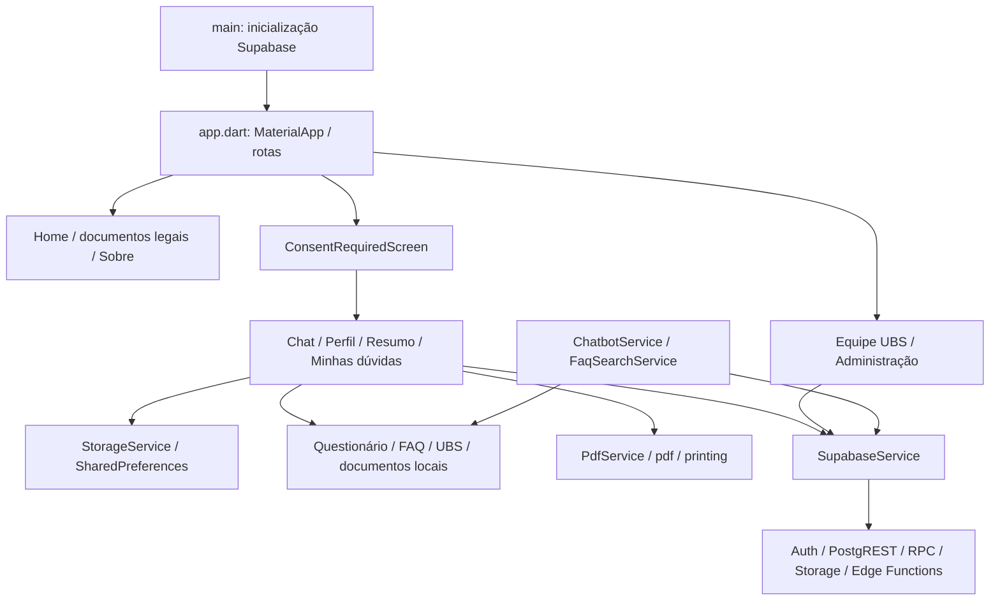

# Petita — auditoria funcional offline, fase 2

Base: `main`, commit `d89bd24bc8369227debfa320d39115eee0aeb007`. Branch: `audit/fase-2-funcional-offline`. Flutter 3.44.0 / Dart 3.12.0. Dados de teste sintéticos; nenhum cliente Supabase inicializado nos testes.

## 1. Arquitetura e fluxos de dados

O aplicativo mantém a arquitetura existente: `StatefulWidget` nas telas, serviços Dart e modelos serializáveis. Não há camada de estado global para o plano. As telas recarregam dados locais por meio de `StorageService`. Não foram reconstruídos componentes ou rotas.

- `main.dart` inicializa Supabase; os testes montam `PlanoPartoPetSaudeApp` ou telas diretamente, sem chamar `main`.
- `app.dart` registra 12 rotas. `/chat`, `/summary`, `/profile` e `/my-questions` passam pelo consentimento. `/terms`, `/ciencia-inicial`, `/privacy`, `/responsibility` e `/about` são públicas. `/ubs` e `/admin` têm bloqueios próprios baseados no perfil **online**.
- `BirthPlanFlowService` e `UbsService` leem assets; os modelos `BirthPlanQuestion`, `BirthPlanAnswer`, `UserProfile` e `ConsentRecord` serializam os dados.
- `StorageService` usa chaves locais para plano, perfil e consentimento. Também possui armazenamento de dúvidas, UBS adicionais e documentos locais, mas esses métodos não constituem uma fila offline ligada às telas remotas atuais.
- `ChatScreen` apresenta as perguntas, seleções e explicações existentes; salva a cada resposta. Após esta correção, retoma a primeira pergunta sem resposta e preserva as demais. Um plano completo pode ser revisado desde a primeira pergunta, sem apagar as respostas ainda não substituídas.
- `BirthPlanSummaryScreen` carrega o registro local, gera os dois PDFs, limpa o plano por ação explícita e oferece sincronização com confirmação separada.
- `PdfService` gera bytes com assets locais; `printing` faz a entrega ao mecanismo de compartilhamento. O teste desse último passo usa canal de plataforma simulado.
- `FaqSearchService` consulta FAQ local, base curada online e, se não houver correspondência, `ask-petita-rag`. A implementação tenta consultar a base online mesmo quando existe resultado local. O fallback foi exercitado sem cliente remoto; latência e erros HTTP reais permanecem pendentes.

### Mapa funcional por perfil

| Perfil / funcionalidade | Estado observado | Evidência / dependência |
| --- | --- | --- |
| Gestante — cinco aceites e bloqueio de links diretos | Implementado e testado offline | Quatro rotas protegidas, retorno sem aceitar, leitura de documento sem perder marcação, versão atual e revogação |
| Gestante — perfil e UBS oficial/manual | Implementado e testado offline | Seleção, persistência, recuperação, limpeza e preservação da identidade local; UBS manual permanece sem código oficial |
| Gestante — 31 perguntas | Implementado e testado offline | Percurso completo pelo widget, respostas únicas/múltiplas, desmarcação, texto livre e descrição cultural |
| Gestante — salvar, recuperar, editar e excluir plano | Implementado e testado offline após correção | Retomada de plano parcial, substituição sem perder outras respostas, reinicialização simulada e limpeza explícita |
| Gestante — edição pontual no resumo | Não implementada | Resumo é de leitura; a revisão ocorre pelo chat. Não foi criada nova interface de edição |
| Gestante — declaração PDF | Implementado e testado em bytes/estrutura/conteúdo | Inclui idade gestacional; planos que excedem uma página mesmo na fonte mínima produzem erro explícito |
| Gestante — modelo visual PDF | Implementado com resumo e registro completo | Primeira página preservada; páginas seguintes incluem todas as respostas conhecidas, sem os cortes dos cartões |
| Gestante — FAQ e fallback | Parte local exercitada | Assets reais; consulta desconhecida sintética; nenhuma chamada remota |
| Gestante — cadastro/login, sincronização e dúvidas | Interface e integração implementadas; operação remota não homologada | Auth, `profiles`, `birth_plans`, RPCs de dúvidas e histórico |
| Equipe UBS — login, solicitação de acesso e resposta | Interface e integração implementadas; operação remota não homologada | Conta nasce paciente e solicita autorização; perfil `ubs_team`, UBS, view anonimizada e RPC de resposta dependem do backend |
| Administrador — UBS, solicitações, categorias e base curada | Interface e integração implementadas; operação remota não homologada | Perfil `admin`, tabelas e RPCs. Perfil local forjado não desbloqueia a administração no teste offline |
| Administrador — PDF/DOCX de apoio e RAG | Código presente; execução não verificada | Storage, processamento em lotes, busca vetorial, Edge Functions e Cloudflare Workers AI |
| Notificações, fila de envio offline e recuperação do plano remoto | Não identificadas no fluxo atual | Sincronização insere um snapshot; não há fluxo implementado de restauração/mesclagem do plano pela nuvem |

Não se conclui que os serviços remotos estejam desativados ou incorretamente configurados: sua situação real não foi consultada. O código local e os SQLs/documentos de referência não comprovam o estado publicado das permissões ou integrações.

## 2. Defeitos comprovados e correções

| ID | Esperado | Observado antes da correção | Correção e teste de regressão |
| --- | --- | --- | --- |
| F01 | Retomar/revisar sem apagar respostas ainda não substituídas | `_startPlanFlow` executava `clearAnswers`, zerando o registro ao tocar “Montar meu plano” | Recarregar o registro e encontrar a primeira pergunta sem resposta; se completo, revisar desde o início. `reopening a partial plan...`, `revising a completed plan...` |
| F02 | Recuperar uma seleção vazia na mesma pergunta | Aviso substituía a última mensagem ativa por uma mensagem sem opções; as alternativas desapareciam | Aviso mantém alternativas, conclusão e ajuda. `empty multiple selection...` falhou antes e passou após a correção |
| F03 | Manter escolhas múltiplas ao acrescentar texto | Digitar um complemento salvava somente o texto e descartava as escolhas | Unir seleções e texto sem duplicação. `multiple choices and typed complement...` reproduziu a perda |
| F04 | Um duplo toque responder uma vez | Duas gravações concorrentes avançavam o índice e pulavam a próxima pergunta | Bloquear nova resposta durante gravação/apresentação. `rapid double submission...` reproduziu o salto |
| F05 | Comando pendente não navegar depois de voltar | O callback de 160 ms ainda tentava abrir uma rota durante a saída do chat | Conferir `mounted` e se a rota continua atual antes de despachar comandos. `leaving chat during a pending command...` |
| F06 | Abrir modo local mesmo com JSON inválido | JSON, tipos e perfil malformados lançavam exceções no carregamento | Fallback de leitura para plano vazio/perfil ausente, sem remover o registro bruto. Oito casos em `storage_recovery_test.dart` falharam antes |
| F07 | PDF da declaração incluir todas as respostas | `semanas_gestacao` não estava no mapeamento do documento | Incluir o valor informado, sem modificar a pergunta ou alternativas. Teste com 31 marcadores identificou `AUDIT02` ausente |
| F08 | Exportação visual conservar as escolhas registradas | Mapeamento incompleto e limites `take(4)`/`take(5)` omitiam respostas; `ESCOLHA5` em diante desapareciam | Preservar o resumo existente e acrescentar registro completo paginado com as perguntas originais. Testes verificam 31 marcadores e todas as seleções |
| F09 | Plano extenso caber por completo ou mostrar o erro de tamanho existente | `pw.Page`/`pw.Column` podiam salvar conteúdo excedente/omitir filhos sem lançar erro; tentativas com fonte menor não eram acionadas | Verificar os filhos e limites da coluna da declaração; usar as tentativas e mensagem de legibilidade já existentes. Teste de 1500 repetições reproduziu exportação em vez de erro |
| F10 | Controles caberem em telas estreitas | Overflows em Home (320 px), botões do perfil (390 px) e dropdown de UBS (320/390 px) | Texto flexível e dropdown limitado à largura disponível; nenhum redesenho. Matriz de widget em quatro dimensões |
| F11 | “Sim, vou descrever” permitir digitar a preferência | O marcador era salvo como resposta e o fluxo avançava sem coletar a descrição | Manter a pergunta ativa e solicitar texto; salvar somente a descrição. `choosing to describe a cultural preference...` falhou antes |

F01 foi identificado no código e coberto pelos testes de preservação/retomada; os demais casos possuem reproduções específicas ou matriz de falhas anteriores. As primeiras versões dos testes também expuseram problemas do próprio harness (cache de Futures de assets entre zonas de teste e suporte a xref stream do PDF); essas falhas de teste foram corrigidas e não são contabilizadas como defeitos do produto.

Os bytes de `assets/data/birth_plan_flow.json`, as explicações, a FAQ, os documentos legais e as regras de risco não foram alterados. O campo de mensagem continua aceitando texto livre; não foram introduzidas regras clínicas ou regras para combinações de preferências.

## 3. Cobertura automatizada

Os quatro arquivos de teste anteriores permanecem intactos (16 testes). Foram acrescentados:

| Arquivo | Casos novos | Cobertura funcional |
| --- | ---: | --- |
| `test/chat_flow_test.dart` | 10 | 31 perguntas, seleção/desmarcação, texto, retomada, revisão, UBS manual, descrição cultural, duplo envio e saída durante callback |
| `test/storage_recovery_test.dart` | 9 | Oito registros malformados e restauração do backing store sintético com plano, consentimento e perfil |
| `test/navigation_layout_test.dart` | 14 | Quatro links protegidos, leitura/retorno, 11 destinos, bloqueio administrativo, estado vazio/exclusão, cancelamentos e quatro dimensões |
| `test/profile_offline_test.dart` | 3 | Entrada vazia, UBS manual/restauração/limpeza, troca para UBS oficial sem perder identidade |
| `test/pdf_service_test.dart` | 9 | Dois formatos, 31 respostas, escolhas múltiplas, vazio, estrutura PDF, assinatura, compartilhamento simulado e limite de tamanho |
| `test/faq_offline_test.dart` | 3 | Base local, consulta vazia/desconhecida e fallback sem inventar resposta |
| **Total acrescentado** | **48** | **64 testes no total, incluindo os 16 anteriores** |

Os testes de PDF inspecionam o cabeçalho, EOF, referência cruzada, páginas e strings dos streams descomprimidos gerados pela biblioteca atual. O leitor de teste é específico para esses arquivos sem criptografia; não é um parser genérico de PDF. Os fixtures sintéticos são gravados em `build/test_artifacts/petita/` para conferência independente. O compartilhamento real do navegador não é executado.

### Verificação final

| Verificação | Resultado |
| --- | --- |
| `flutter pub get --enforce-lockfile` | Código 0; manifesto e lockfile preservados; avisos de dependências já existentes |
| `flutter analyze` | Código 0; nenhum apontamento |
| `flutter test --no-pub --coverage --concurrency 4 --reporter expanded` | Código 0; 64 testes aprovados, zero falhas/skips, 38 segundos |
| `flutter build web --release` | Código 0; 76,4 segundos; `build/web` gerado e Wasm dry run aprovado |
| Poppler (`pdftotext -layout` e `pdfinfo`) nos fixtures sintéticos | Leitura independente aprovada: 31 marcadores nos dois PDFs; declaração de 1 página, resumo com registro completo de 3 páginas |
| Comparação binária com `origin/main` | Questionário e quatro arquivos de testes anteriores intactos |
| Comparação do asset empacotado com o fonte | Conteúdo idêntico, 31 perguntas preservadas |
| `git diff --check` | Aprovado |

Cobertura de linhas reportada pelo LCOV: **1410/2402 (58,7%)** no total instrumentado. Por componente: chat **61,9%**, armazenamento **51,7%**, PDF **100%**, perfil **71,2%**, consentimento **93,6%**. A cobertura inclui telas/serviços remotos que não foram acionados; não se exige um percentual artificial para eles. Mesmo 100% de linhas do gerador PDF não comprova todos os dados possíveis nem a aparência impressa.

Os comandos de instalação, análise e build foram executados sem export manual de PATH. Nenhuma dependência foi acrescentada ou atualizada. `coverage/` foi incluído no `.gitignore` para manter o relatório gerado fora do versionamento.

## 4. Limitações e próxima fase

1. **Validação real no navegador pendente.** Testes de widget verificam ausência de exceções/overflows nas telas offline em 320×640, 390×844, 768×1024 e 1440×900. Não comprovam aparência, legibilidade, teclado virtual, download/compartilhamento, acessibilidade ou comportamento do histórico do navegador. Não houve execução ou alteração do sandbox do Chromium.
2. **Integrações remotas pendentes.** Validar em ambiente de testes com contas sintéticas: confirmação de e-mail, expiração de sessão, separação de gestantes/UBS/admin, RLS, anonimização, RPCs, armazenamento, processamento e exclusão de documentos e RAG. Nenhum resultado desta PR certifica as políticas efetivamente publicadas.
3. **Offline não equivale a restauração após perda de dados do navegador.** Os testes simulam reinicialização preservando o armazenamento; não reinstalação, limpeza de cache, outro dispositivo ou restauração pela nuvem. SharedPreferences não acrescenta criptografia por conta própria. Confirmar a política de dados compartilhados no mesmo dispositivo ao trocar de conta.
4. **PDF.** A declaração preserva o limite existente de uma página e avisa quando o registro excede a capacidade mínima; o modelo visual contém o registro completo nas páginas seguintes. Validar visualmente impressão A4 e planos reais em cenários autorizados. As fontes PDF atuais são Helvetica; suporte amplo a caracteres fora do repertório dessas fontes permanece pendente.
5. **Recuperação de corrupção.** A leitura inválida retorna vazio/ausente e preserva os bytes até uma gravação explícita; não reconstrói respostas parcialmente corrompidas. Aviso/backup/exportação de dados locais e política de recuperação são melhorias futuras.
6. **Revisão do plano.** A revisão começa no chat; edição direta de uma resposta no resumo e apresentação das escolhas anteriores como pré-seleção são melhorias futuras, sem nova interface nesta PR.

Não houve deploy, merge, acesso a banco de produção, migração Neon, alteração do Diário da Gestante, mudança de schema ou alteração das proteções do navegador.
