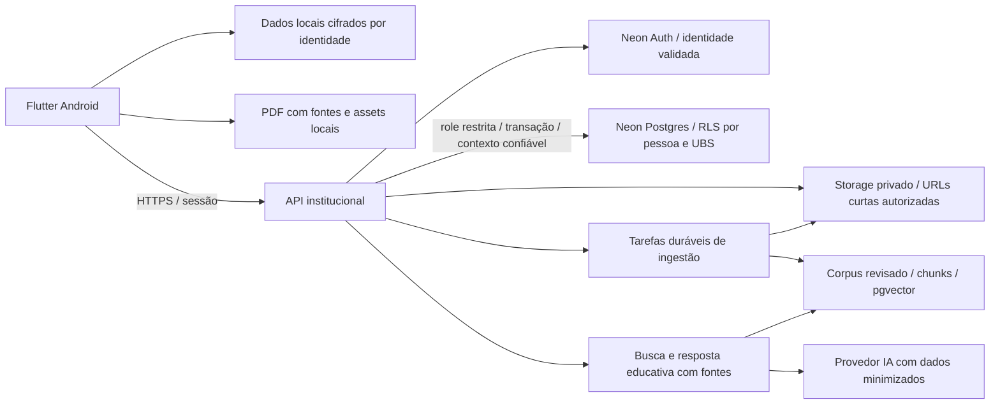

# Petita — diagnóstico integrado Flutter, Neon, Android e NITT/INPI

Data: 28/10/2026. **Decisão: não liberar para distribuição com dados reais.** A base offline tem evidência automatizada favorável; a integração institucional online, o isolamento de usuários e UBS, a proteção local e a cadeia de release ainda têm bloqueadores. Este diagnóstico antecede qualquer mudança estrutural.

## 1. Escopo, evidências e limites

- Código auditado: `main`, commit `344f3b024dabf40cd91a6792731d86d14b83fb50`, checkout inicialmente limpo. Não foram modificados aplicação, questionário, conteúdos clínicos, termos, dependências ou workflows. Esta entrega acrescenta somente dois relatórios.
- [PR #8](https://github.com/petsaudemonitoramento-dev/petita-plano-parto/pull/8), aberta, head `206b4025cb2a5bbd7f18cde77155e27d8e13e0e0`: lidos diff e arquivo [AUDITORIA_NEON_ESQUEMAS_2026-10-28.md](https://github.com/petsaudemonitoramento-dev/petita-plano-parto/blob/206b4025cb2a5bbd7f18cde77155e27d8e13e0e0/documentos/AUDITORIA_NEON_ESQUEMAS_2026-10-28.md). Esse arquivo está na PR, ainda não na main local.
- [PR #6](https://github.com/petsaudemonitoramento-dev/petita-plano-parto/pull/6), aberta, head `ca44632088154583b30e8d03131dea2e1bd93e89`: lidos diff, metadados de execução, etapas do job e metadados do artefato. Não houve download, instalação ou inspeção binária do APK.
- Neon: projeto institucional `round-cherry-59699884`, branch `main`, `br-rough-credit-b648szjj`; consultados exclusivamente `neondb` e `petita_snapshot_pessoal_20261028`. A organização institucional indicada pelo solicitante é o destino; titularidade administrativa, recuperação de conta e governança do projeto não são comprovadas por catálogos SQL.
- `PETITA_NEON_AUDIT_URL` está **ausente** no processo. Portanto, não foi possível testar essa conexão dedicada. A política local não autoriza destinos TCP; não foi tentado acesso PostgreSQL direto nem contorno da rede. O conector Neon funcionou e permitiu leitura atual dos catálogos e contagens.
- A primeira consulta MCP foi um `SELECT` de metadados, sem transação explicitamente read-only. As consultas detalhadas e contagens usaram `SET TRANSACTION READ ONLY`; uma consulta confirmou `transaction_read_only=on` em cada banco. A conexão técnica padrão não é, por isso, uma credencial de auditoria limitada: a role proprietária tem bypass de RLS. **Nenhuma escrita foi executada em banco.**
- Não foram lidos registros individuais, dados de gestantes, conteúdos da base clínica remota, senhas, tokens ou strings de conexão. Não houve acesso ao Neon pessoal nem ao Supabase original, execução de RPCs de aplicação, criação de branch de banco, merge, deploy ou publicação.
- O [anexo de evidências](EVIDENCIAS_NEON_INTEGRADA_2026-10-28.md) apresenta todas as diferenças encontradas de colunas, defaults, constraints e índices, definições de views/funções e contagens. Evidência estática e evidência de catálogo não substituem testes com identidades reais de homologação.

## 2. Resultado e riscos priorizados

Criticidade aqui mede impacto e bloqueio de liberação. “Crítico” não significa incidente comprovado. Não foi comprovado acesso indevido aos dados existentes.

| ID | Criticidade | Achado e evidência | Consequência / condição de saída |
|---|---|---|---|
| R01 | Crítica | Zero policies, RLS ativa nas 15 tabelas de cada banco; owner com BYPASSRLS; sem role de aplicação observada | Não existe autorização funcional homologada. Criar role restrita e políticas por sujeito/UBS; aprovar testes negativos de todas as operações |
| R02 | Crítica | Flutter ainda usa Supabase Auth/PostgREST; Neon Auth desabilitado; `profiles.id` confundido com ID autenticado | A migração de dados não migrou login nem identidade. Resolver mapeamento de usuários e sessão antes de qualquer corte |
| R03 | Crítica | View sem filtro UBS; quatro RPCs ausentes; cliente consulta a view apenas por status; nenhuma autorização equivalente implementada no Neon | Fluxos de dúvidas/admin indisponíveis; implementação ingênua poderia cruzar UBS. Exigir isolamento no servidor e no banco |
| R04 | Alta | JSON clínico/perfil e sessão em SharedPreferences; nenhum armazenamento criptografado configurado | Exposição em dispositivo comprometido, cópias/transferências e manutenção. Criptografia, regras de backup, gestão de chaves e testes em Android |
| R05 | Alta | Respostas, consentimento e perfil em chaves globais; logout preserva plano; sync usa usuário atual e respostas globais | Possível envio do plano de uma pessoa pela conta seguinte em aparelho compartilhado, inferido do código; reproduzir com dados sintéticos e corrigir segregação |
| R06 | Alta | `neondb` carece de campos usados pelo app; snapshots não têm RPCs; contratos de identidade/consentimento divergem | Falhas de execução e integridade apesar de compilar. Contratos e migrações versionados, sem escolher um banco como alvo por conveniência |
| R07 | Alta | Sync é INSERT manual, sem idempotência, fila, pull ou resolução de conflito | Duplicação em retry, falsa expectativa de recuperação e perda de alterações entre aparelhos. Definir e testar semântica de sincronização |
| R08 | Alta | RAG/Storage/processamento continuam no Supabase/Cloudflare; chave pública é a única barreira própria da consulta RAG | Cópia PostgreSQL não restabelece RAG; abuso/custo e transmissão de texto sensível. Migrar backend, impor limites e revisar tratamento de dados |
| R09 | Alta | Ausência de `android/` permanente e de configuração release auditável | Sem identidade Android, permissões, backup e assinatura definitivos; debug CI não fecha essa lacuna |
| R10 | Alta | Nenhuma homologação Android física, Auth, UBS, RAG ou sync E2E nesta auditoria | 67 testes passam, mas não provam prontidão operacional. Completar matriz por perfil, rede e dispositivo |
| R11 | Média | Aceites são só locais, sem vínculo de conta/hash do documento no fluxo online; schemas remotos divergentes | Evidência insuficiente para reconstruir qual versão foi aceita e em qual envio. Contrato técnico e revisão institucional, sem editar os textos atuais |
| R12 | Média | Versões duplicadas, ausência de licença geral/manifesto de autoria, temporários Supabase versionados, publicação web com SDK flutuante | Reprodutibilidade e dossiê incompletos; inventariar direitos, limpar metadados de tooling e unificar release |

Bloqueiam uso real R01–R10. R11–R12 também devem estar resolvidos para a versão institucional estável e seu dossiê. O aplicativo pode continuar sendo avaliado offline com dados exclusivamente sintéticos em ambiente controlado.

## 3. Banco: diferenças detalhadas e relação com o código

### 3.1 Inventário confirmado ao vivo

| Métrica | neondb | Snapshot institucional |
|---|---:|---:|
| Tabelas / colunas de tabelas | 15 / 126 | 15 / 134 |
| Índices / restrições | 31 / 46 | 39 / 46 |
| Políticas RLS / funções próprias públicas | 0 / 0 | 0 / 2 |
| Views públicas | 1 | 1 |
| Total de registros, apenas contagem | 11 | 24 |

Contagens positivas: `knowledge_categories` 8/8; `ubs` 3/3; `knowledge_base` 0/3; `profiles` 0/1; `warning_sign_options` 0/9. As outras dez tabelas estão vazias nos dois bancos, inclusive planos, dúvidas, respostas, documentos de apoio, chunks, logs e aceites. Isso não demonstra ausência de dados no Supabase nem valida fluxo clínico. Não foram comparados conteúdos nem recalculados hashes de linhas. O workflow de validação anterior de 15 tabelas é uma evidência relatada pela PR #8, não reexecutada aqui.

### 3.2 Campos e contratos incompatíveis

| Área | Diferença real | Uso no Flutter / implicação |
|---|---|---|
| Plano | Só snapshot tem `companion`, `pdf_generated_at` | `SupabaseService.syncBirthPlan` envia ambos; INSERT correspondente falharia em neondb |
| Identidade | `profiles.id` UUID interno em ambos; `auth_user_id` UUID em neondb e texto no snapshot; só snapshot tem `legacy_supabase_user_id` UUID | `loadOnlineProfile` e `updatePatientProfile` filtram `id=user.id`; sync grava esse ID em `patient_id`. IDs de Auth não podem ser substituídos diretamente sem mapeamento |
| Upload/solicitação | `support_documents.uploaded_by`, `team_access_requests.user_id/decided_by`: UUID em neondb e texto no snapshot; uploaded_by obrigatório apenas em neondb | Código usa IDs Auth para esses campos, enquanto várias FKs institucionais apontam para profiles. Definir se são atores internos ou sujeitos externos |
| Dúvidas | Só snapshot tem `self_risk_level`, `has_warning_signs`, `warning_signs`, `urgency_acknowledged`, `expected_response_notice_accepted`, `updated_at` | Modelo `AnonymousQuestion` espera esses campos; defaults do parser mascaram ausência como risco baixo/sem sinais. Não aceitar silenciosamente contrato incompleto |
| Aceites | neondb: `patient_id`, `consent_version`, `metadata`; snapshot: `user_id`, `privacy_version`, `responsibility_version`; accepted_at obrigatório só em neondb | `ConsentRecord` local tem cinco flags e uma versão, sem upload ao banco. Não há equivalência automática entre contratos |
| Sinais de atenção | description/risk_level/sort_order só em neondb; snapshot tem 9 registros, neondb zero | Contagem não valida significado clínico nem autoriza sobrescrever catálogo. Preservar conteúdo e exigir revisão clínica para qualquer futura alteração |
| Conhecimento | `knowledge_base.created_at`, `knowledge_documents.file_path` só no snapshot | `knowledge_documents` legado e `support_documents` do RAG são entidades distintas; não trocar um pelo outro |

Há diferenças adicionais de nulidade: snapshot é mais estrito em datas/flags de planos, conhecimento, perfis e UBS, status/risco das dúvidas, question_id/data das respostas e code de sinais. Defaults diferentes: snapshot cria `public_code` com prefixo e oito caracteres derivados de UUID; neondb não tem default. Snapshot usa nome vazio e role patient por padrão em profiles; neondb exige valores explícitos. A lista campo a campo está no anexo.

O futuro schema deve preservar dados, validar contratos e normalizar identidade antes de impor NOT NULL/FK. Não converter flags/dados ausentes em respostas clínicas presumidas. Não gerar aceites retroativos a partir de defaults.

### 3.3 Restrições e índices

- Sete FKs mudam de ação de exclusão. No snapshot, plano→perfil, dúvida→perfil, base→revisor/documento, documento→uploader e resposta→autor usam `ON DELETE SET NULL`; resposta→dúvida usa `CASCADE`. Em neondb essas sete usam a ação padrão `NO ACTION`. A escolha afeta retenção, histórico e exclusão; SET NULL não anonimiza texto livre nem `patient_name`/answers_json.
- Snapshot adiciona constraints de unicidade em public_code, auth_user_id e legacy_supabase_user_id. Neondb tem FKs extras para uploader de support_documents e user/decisor de team_access_requests; o snapshot não as tem. Aceites usam FK para profiles via patient_id ou user_id, com CASCADE nos dois casos. Mesmas 46 constraints não significam mesma integridade.
- Snapshot tem nove nomes de índices exclusivos: unicidades de código público, identidades e email normalizado; acessos por UBS de perfil, paciente dos vínculos, usuário dos aceites, dúvida/data da resposta e código dos sinais. Neondb tem um nome exclusivo, `idx_patient_questions_public_code`.
- **Correção da interpretação por nomes:** esse índice de neondb já é UNIQUE parcial para public_code não nulo. Ambos impedem duplicar códigos não nulos; nenhum exige por isso que o código exista. Não alegar que neondb não possui unicidade de código.
- O nome comum `idx_patient_questions_ubs_status` encobre definição diferente: `(ubs_code,status)` em neondb; `(ubs_code,status,created_at)` no snapshot. Comparar definições e planos de consulta, não apenas nomes/quantidade de índices.
- Os checks observados restringem role/status, mas FKs separadas de dúvida, UBS e autor não asseguram que a resposta pertença à UBS da pergunta nem que seu autor seja membro ativo. Isso exige contrato e autorização transacional.

### 3.4 Funções, views e RLS

No snapshot existem apenas `get_support_documents_storage_usage()` e `match_support_document_chunks(vector,double precision,integer,text)`. Ambas são SQL STABLE, SECURITY INVOKER, search_path public; não são as mesmas definições SECURITY DEFINER dos patches Supabase. Neondb não tem funções próprias públicas. Nenhum trigger de aplicação foi retornado nos dois bancos; portanto não há criação automática de perfil observada.

As RPCs do Flutter `submit_patient_question`, `list_my_patient_questions`, `respond_to_patient_question` e `decide_team_access_request` estão ausentes nos dois bancos. `is_admin` e `handle_new_user` dos SQLs legados também não constam nas funções públicas observadas. `submit_patient_question` e `respond_to_patient_question` não têm definição nos SQLs versionados atuais; a infraestrutura histórica completa não é reconstruível só pelos patches existentes.

A view `team_questions_anonymous` existe nos dois bancos com `security_invoker=true`, ponto positivo que evita executar como proprietário. Porém, ambas selecionam dúvidas **sem WHERE de UBS**. A de neondb retorna risk_level/answered_at; a do snapshot retorna self_risk_level/has_warning_signs/warning_signs e corresponde melhor ao modelo Dart. O cliente filtra somente status pending e ordena data: o isolamento deve vir do servidor/RLS, não da tela.

RLS habilitada sem policies nega linhas para roles comuns que tenham acesso à tabela; não é uma política de separação por gestante/UBS. Proprietários normalmente a contornam e roles BYPASSRLS sempre a contornam, inclusive com FORCE RLS. Todas as tabelas têm FORCE desligado; neste projeto o owner tem BYPASSRLS. ACLs de relações são nulas, com privilégios padrão do proprietário; não foram observados grants explícitos de aplicação. Não há evidência de exposição pública atual, mas usar owner num futuro backend eliminará a proteção esperada. [Semântica oficial do PostgreSQL](https://www.postgresql.org/docs/current/ddl-rowsecurity.html).

## 4. Identidade, perfis e isolamento recomendado

Neon Auth está desabilitado na branch segundo a API de controle (404 específico); não há schema neon_auth nos dois bancos. Data API de neondb não foi encontrada. A branch de homologação `migracao-petita-homologacao-2026-10-28` já existe, mas não teve conteúdo nem isolamento auditados. Não foi criada ou alterada por este trabalho.

Recomenda-se Neon Auth gerenciado, sujeito a um pequeno protótipo Flutter/Android em homologação. A documentação atual oferece integração Better Auth e SDK JavaScript; o `SupabaseAuthAdapter` documentado é JavaScript, **não uma substituição garantida de supabase_flutter**. Validar HTTP/SDK compatível, sessão nativa, renovação, logout, verificação de email e recuperação antes da migração. Senhas Supabase não são transferíveis pelo procedimento documentado; planejar nova autenticação e vinculação validada, sem prometer preservar sessões ou IDs. [Guia de migração Neon](https://neon.com/docs/auth/migrate/from-supabase), [Neon Auth](https://neon.com/docs/auth/overview).

Modelo proposto, ainda não aplicado:

1. Manter `profiles.id` UUID interno estável, utilizado em patient_id, answered_by, uploaded_by e decisões. Representar o sujeito Auth como identificador opaco em `auth_user_id text UNIQUE`, ou em tabela de identidades `(issuer,subject,profile_id)` se houver transição entre provedores. Não presumir que todo subject seja UUID; confirmar o contrato real ao habilitar Auth em homologação.
2. Guardar `legacy_supabase_user_id` como correspondência histórica com acesso administrativo restrito. Não vincular automaticamente por email digitado, nome, ID local ou metadados enviados pelo cliente. Exigir prova de identidade e trilha de reconciliação para preservar as FKs existentes.
3. Criar perfis idempotentemente em operação confiável, sempre patient inicialmente; roles, active e vínculos de equipe só podem mudar por processo administrativo autorizado. `user_metadata` não define privilégio. Solicitações não equivalem a aprovação.
4. Manter vínculo de equipe UBS aprovado e ativo no servidor. Definir transferência de UBS sem abrir histórico de outra unidade. A UBS de uma pergunta fica validada na transação; resposta deriva a UBS da pergunta, nunca confia no corpo enviado.
5. A API resolve o sujeito a profile_id em toda operação; valida assinatura, issuer, expiração e destinatário do token conforme o contrato efetivo. Confere perfil ativo/vínculo atuais, inclusive após suspensão. Planejar janela residual de JWT e revogação; logout local não garante invalidar imediatamente todo token emitido.

| Ator | Acesso permitido proposto | Acesso negado / teste obrigatório |
|---|---|---|
| Sem sessão | Questionário/FAQ/UBS/assets locais; eventualmente catálogo público aprovado | Planos, perfis privados, dúvidas, vínculos de pacientes, respostas privadas, logs, uploads e administração |
| Gestante | Próprio perfil com campos editáveis limitados, planos próprios, próprias dúvidas/respostas, seus aceites | Alterar role/active, listar outra gestante, escolher patient_id arbitrário, acessar tabela de vínculo de terceiros ou assumir equipe |
| Equipe UBS aprovada | Perguntas pseudonimizadas destinadas à sua UBS e respostas correspondentes | Nomes, emails, perfis, planos completos, question_patient_links e dados de outras UBS; aprovar a si própria |
| Administrador | Gerir UBS, acessos de equipe e conteúdo autorizado, com registro das ações | Acesso clínico irrestrito por padrão. Necessidades excepcionais exigem papel/permissão próprios e justificativa institucional |
| Worker RAG | Documentos autorizados, chunks e tarefas de ingestão/busca | Planos, perfis, dúvidas privadas e identidade das gestantes |

Não chamar o canal de estritamente anônimo: existe vínculo reversível e o texto livre pode conter identificação. A minimização de campos não remove esse risco. Validar texto e acesso, limitar exports, não registrar payloads sensíveis e submeter eventual adequação da terminologia legal/UX à autorização institucional.

Exigir policies para SELECT/INSERT/UPDATE/DELETE, `USING` e `WITH CHECK`, grants mínimos, proteção de colunas privilegiadas e revisão de EXECUTE das funções. A role runtime será não proprietária, sem BYPASSRLS, sem capacidade de SET ROLE para owner/DDL. Se a API usar contexto de sujeito via configuração de transação, defini-lo somente após validar a identidade e usar SET LOCAL por transação para evitar vazamento em pool; isso não pode ser controlado pelo APK. FORCE RLS isoladamente não corrige uma role com bypass.

## 5. Dependências Supabase, offline e RAG

### 5.1 Inventário remanescente

| Componente | Dependência atual | Trabalho necessário |
|---|---|---|
| pubspec / main | supabase_flutter; inicialização Supabase antes de runApp | Separar núcleo offline e adapters remotos; falha remota não pode impedir abertura local |
| config | URL/chave pública constantes em supabase_config.dart, sem dart-define | Configuração por ambiente contendo apenas endpoints públicos/flags; segredos só no servidor |
| SupabaseService | Auth, tabelas PostgREST, RPCs, Storage e Functions | Adapter HTTP para API institucional e contratos explícitos |
| FaqSearchService | Acesso direto adicional a Supabase.instance e knowledge_base | Passar pela interface de repositório; garantir resposta local sem espera remota indefinida |
| Telas | Menções ao Supabase e chamadas ao serviço no chat, perfil, resumo, UBS/admin/histórico | Ajustar integração sem alterar textos clínicos/legais; tratar erros com mensagens seguras |
| SQLs | auth.uid(), auth.users, auth.jwt(), roles authenticated/service_role, storage.objects, functions definer | Não executar esses patches literalmente no Neon; escrever migrations compatíveis e testadas |
| 3 Edge Functions | Deno/EdgeRuntime, supabase-js, getUser, service_role, Storage, autorrecursão HTTP | Portar runtime, autenticação, autorização, jobs e credenciais |
| Supabase tooling | config.toml e 8 arquivos em .temp versionados | Remover metadados temporários do pacote/repo futuro, revisar histórico por segredos sem reproduzi-los |
| Privacidade/README | Descrevem infraestrutura Supabase e funcionalidades de recuperação | Revisão institucional antes do corte; não alterar conteúdo legal nesta auditoria |

Não foi auditado o estado publicado do Supabase. Referência a chave pública no cliente não é por si vazamento de segredo; ela também não autentica uma pessoa. Não se deve colocar DATABASE_URL, senha Postgres, chave de administração ou Cloudflare no APK, nem por `--dart-define`: valores compilados são extraíveis.

### 5.2 Capacidade offline realmente implementada

O plano é persistido após respostas, retomado e exportado localmente. Os PDFs carregam fontes DejaVu e imagens de assets, sem download de fontes. Consentimento versionado, perfil, FAQ e UBS locais têm testes. O compartilhamento usa `Printing.sharePdf`: testes de canal simulado não validam o mecanismo Android.

`StorageService` serializa respostas, perfil e flags em SharedPreferences sem criptografia própria, em chaves globais. `Supabase.initialize` não fornece storage alternativo; o SDK instalado, supabase_flutter 2.16.0, usa SharedPreferencesLocalStorage por padrão para persistir sessão. Não foram extraídos tokens. O sandbox do Android é uma proteção existente, mas não substitui proteção de dados locais, backup e exportação.

Logout do perfil encerra sessão online, preservando perfil/respostas; login seguinte sobrescreve perfil, mas não as respostas. `_syncOnline` usa respostas globais e `currentUser` novo. A revogação apaga consentimento/plano/perfil, mas não encerra a sessão nem limpa `ubs_questions` ou arquivos já compartilhados. Os métodos locais de dúvidas/documentos não constituem fila remota e precisam ser inventariados na limpeza. Esses fatos exigem teste de dispositivo compartilhado; não foi simulado acesso entre contas online aqui.

Recomendação: armazenamento clínico transacional cifrado, chaves protegidas pelo Android Keystore, tokens em armazenamento seguro, partições por identidade e área local sem conta com vinculação explícita. Migração local deve tolerar interrupção e preservar os bytes legados até confirmar gravação válida. Definir logout, troca de conta, exclusão/revogação, retenção, bloqueio de tela e limpeza de temporários. Não afirmar apagamento de PDFs enviados a outros aplicativos nem exclusão remota pela ação local.

A sincronização atual **não é bidirecional**: INSERT manual de snapshot, sem identificador idempotente, outbox durável, pull, tombstones, revisão ou conflito. Também grava pdf_generated_at ao sincronizar, sem comprovar geração de PDF. Propor IDs de plano/revisão e operação, chave de idempotência, controle de versão no servidor, fila cifrada por conta, ACK transacional e retry limitado. Nunca reenviar dados pendentes sob outro usuário. Definir a UX de conflito e recuperação sem sobrescrever respostas silenciosamente.

| Funcionalidade | Sem conexão | Dependência online |
|---|---|---|
| 31 perguntas, edição pelo chat, retomada, perfil/UBS locais | Disponível nos testes | Nenhuma para dados locais |
| Gerar bytes dos dois PDFs | Disponível nos testes | Compartilhamento Android ainda precisa de aparelho; destino pode usar internet |
| FAQ fixa | Disponível | Código ainda tenta base online mesmo com resultado local; medir timeout/latência |
| Cadastro/login, verificação e recuperação | Não disponível | Auth institucional |
| Enviar/sincronizar/recuperar plano | Só persistência local | API/Neon; recuperação remota ainda não implementada |
| Dúvidas/histórico/respostas/solicitações/admin | Não operam remotamente offline | API autorizada; fila não implementada |
| RAG, upload, extração, embeddings, remoção remota | Não disponível | Backend, storage e provedor de IA |
| Push | Não implementado | Fora do escopo atual; não pedir permissão sem função |

### 5.3 Compatibilidade Neon e riscos do RAG

PostgreSQL/pgvector são compatíveis: ambos os bancos têm vector 0.8.0, `vector(1024)` e HNSW com distância cosseno, compatível com o contrato esperado pelo código de embeddings BGE-M3. Isso não demonstra disponibilidade de documentos, modelos ou serviço: support_documents/document_chunks estão vazios e a RPC de busca existe apenas no snapshot.

O fluxo atual usa Supabase Storage para PDF/DOCX, Edge Function para conversão, Cloudflare para embeddings/geração e Supabase RPC para busca. Neon Postgres não substitui automaticamente bucket, Auth, PostgREST e Edge Functions. Recomenda-se API institucional com backend de ingestão e storage privado; Neon Object Storage/Functions podem ser opções se região/plano/requisitos forem confirmados. Não é necessário habilitar Data API se o Flutter usar a API própria.

Riscos específicos observados:

- `ask-petita-rag` tem verify_jwt=false e compara apikey com chave pública; não se observa rate limit/cota por ator no código. Proteger contra abuso sem confundir chave pública com autenticação. Se consulta anônima educativa for requisito, expor somente corpus aprovado e impor limites próprios.
- Pergunta completa é enviada ao provedor de embeddings e depois de geração com contexto. O log local da função usa SHA-256 sem sal e tamanho/categoria: evita texto bruto nesse log, mas hash determinístico não garante anonimização de perguntas previsíveis. Definir minimização e retenção com a instituição.
- Prompt instrui usar apenas documentos; isso não garante correção nem resistência a injeção em documento/pergunta. Testar fontes, recusa, indisponibilidade e separação entre corpus educativo e dados clínicos privados.
- A resposta do backend contém fontes, mas FaqSearchService transforma o resultado em FaqItem com apenas answer: referências não são preservadas nessa camada de apresentação. Exigir rastreabilidade sem alterar conteúdo clínico por iniciativa técnica.
- Limite total de 900 MB é consultado pelo cliente e pode sofrer corrida/falha que retorna uso zero; não é quota transacional no servidor. Validar bytes reais, tipo, limites, disponibilidade de espaço e concorrência no backend.
- Upload/insert/processamento e exclusão arquivo/registro não são atômicos entre storage/banco; falhas parciais podem deixar registros apontando para arquivos removidos. Autorrecursão com service_role e EdgeRuntime.waitUntil exige substituição por tarefas duráveis, retry/idempotência e compensação.

## 6. Arquitetura recomendada

O APK se comunica por HTTPS e não recebe credenciais PostgreSQL. API separa identidade de autorização, limita campos e opera com a role restrita. Worker de ingestão não precisa ler planos ou perfis. O schema-alvo será derivado do contrato funcional, reconciliando os dois bancos e preservando o snapshot como evidência. Migrações futuras só em homologação com dados sintéticos, backup/rollback e comparação antes/depois; nenhuma é executada neste ciclo.

## 7. Android: PR #6, permissões e release

A [execução 40626988413](https://github.com/petsaudemonitoramento-dev/petita-plano-parto/actions/runs/40626988413) da PR #6 concluiu com sucesso todas as etapas, inclusive 67 testes e `flutter build apk --debug`. Artefato `petita-apk-debug-teste` existe, aproximadamente 86,7 MB compactado, com expiração informada em 04/11/2026. O digest do GitHub é do artefato, **não deve ser tratado como SHA-256 do APK interno**. Não foi validada sua assinatura, seu manifest ou comportamento em dispositivo.

O workflow gera scaffold temporário, resolve dependências Android sem persistir o lockfile resultante e remove exemplos de teste/análise gerados. É evidência útil de compilabilidade daquele experimento; não é pipeline release. A base da PR #6 é d57ced4, anterior à main auditada. Em eventos pull_request, checkout padrão pode usar merge ref: registrar `git rev-parse HEAD` no futuro, sem assumir que metadado head_sha do artefato prove sozinho os bytes compilados.

Não há arquivos android/ versionados. Sem manifest/Gradle permanentes ou inspeção binária, **não se pode atestar** package ID, min/target SDK, permissões efetivas, exportação de componentes, backup, FileProvider ou assinatura release. Neste ambiente `flutter doctor -v` informa ausência do Android SDK; há Java, mas não toolchain/aparelho. Não foi tentada build Android local nem criado scaffold nesta auditoria.

Critérios para plataforma permanente:

- Definir applicationId institucional estável, namespace, rótulo, ícones, SDKs suportados, Java/Gradle/AGP/Kotlin e Flutter fixados. Revisar manifest mesclado, inclusive dos plugins; preservar lockfile resolvido para Android.
- Declarar INTERNET no manifest de release se houver operações remotas. Template debug não prova essa permissão no release. Usar HTTPS, bloquear cleartext e manter validação TLS. ACCESS_NETWORK_STATE só se a implementação exigir; estado de rede não prova disponibilidade do serviço.
- Não solicitar câmera, microfone, localização, contatos, armazenamento amplo ou notificações sem uma função concreta que justifique. Para escolha/exportação de PDF/DOCX, preferir seletores do sistema/URIs e compartilhamento com permissões temporárias. Testar plugin file_picker e printing, cancelamento e limpeza dos temporários.
- Configurar backups e transferência entre dispositivos explicitamente, com exclusões para dados clínicos e sessões (`fullBackupContent` e `dataExtractionRules` conforme APIs suportadas). Não considerar apenas allowBackup=false uma prova suficiente em todos os fabricantes; testar backup/restore e coerência com chaves Keystore. [Documentação Android sobre backup](https://developer.android.com/identity/data/autobackup).
- Configurar assinatura institucional de release, sem fallback debug. Guardar keystore/senhas em cofre, definir responsáveis e cópia de recuperação; nunca versionar. Separar chave de distribuição direta e estratégia futura de Play App Signing, mantendo capacidade de atualização dos APKs já instalados.
- `pubspec.yaml` declara 0.2.0+20; AppInfo/README dizem beta/build 20 e AppInfo tem data antiga. Definir fonte única de versionName/versionCode, incremento e canal; não chamar beta de estável antes dos gates.
- Build release a partir de checkout limpo e commit fixo; validar `apksigner verify --verbose --print-certs`, fingerprint SHA-256 do certificado, ausência de debug, manifest, versão, ABI e hash SHA-256 do APK final. Assinatura válida identifica o signatário do binário; não comprova funcionalidade ou identidade do commit sem manifesto de proveniência.

Referência de implementação: [Flutter — build e release Android](https://docs.flutter.dev/deployment/android). Instalação limpa e atualização sobre a versão anterior, primeira abertura em modo avião, reinício do processo, compartilhamento, rede intermitente e troca de contas devem ser exercitados no APK release assinado.

## 8. Preparação NITT/UFCG e INPI

O [NITT/UFCG](https://nitt.ufcg.edu.br/formularios-de-solicitacao-de-registros/) pede formulário de solicitação, complementos de autores/titulares, código-fonte em PDF e, quando aplicáveis, termo de derivação e contrato de direitos/cooperação. O PDF institucional é distinto dos PDFs clínicos que o aplicativo gera.

Para o INPI, o titular guarda o arquivo técnico íntegro que originou o hash e informa o resumo/algoritmo no procedimento eletrônico; a documentação técnica pode ser um arquivo ou pacote. A FAQ informa DV e procuração quando cabível como anexos, sem envio ordinário do código-fonte ao INPI. SHA-256 é a escolha deste projeto; não é criptografia reversível nem certificado de qualidade. Confirmar com o NITT o arquivo exato usado no pedido e manter cópias institucionais. [FAQ INPI](https://www.gov.br/inpi/pt-br/acesso-a-informacao/perguntas-frequentes/programas-de-computador), [orientações INPI](https://www.gov.br/inpi/pt-br/servicos/programas-de-computador/guia-completo-de-programa-de-computador).

APK assinado, relatório de segurança e testes são requisitos de engenharia definidos para esta versão; não devem ser apresentados como exigências universais do registro no INPI. Registro de autoria não certifica segurança, validade clínica ou prontidão funcional.

| Entregável futuro | Conteúdo e critério de integridade |
|---|---|
| PDF de código-fonte | Extrair do commit estável, com índice, caminhos, paginação, identificação de versão/commit e seleção representativa de fluxo, persistência, PDFs, integração e backend de autoria do projeto. Texto pesquisável, sem truncamento; identificar exclusões e material de terceiros; confirmar extensão/seleção com NITT |
| Pacote-fonte | Arquivo imutável montado por allowlist de arquivos do mesmo commit, com Flutter, Android permanente, backend, migrations, assets autorizados, lockfiles e documentação necessária. Excluir .git, builds/caches, dumps, .env, secrets, keystores, .temp, dados pessoais e clínicos reais |
| SHA-256 | Calcular sobre os bytes finais do pacote; registrar nome, tamanho, algoritmo e digest de 64 hex. Alterar o arquivo muda o hash. Hash do commit Git, do PDF, do pacote e do APK são identificadores diferentes |
| APK release | Mesmo commit do pacote, build controlado, assinatura institucional verificada, hash próprio, package/versionCode/versionName e certificado identificados; não confundir hash do ZIP de CI com o APK |
| Manifesto externo | Relacionar commit completo, tree/ref, repositório, estado limpo, lista/manifesto de fontes, ferramentas, run da build, ambiente/backend/schema/contratos, hashes do PDF/pacote/APK e fingerprint do certificado. Guardar fora do pacote para evitar auto-hash circular |
| Documentação técnica | Escopo e limitações, diagrama, offline/online, modelo/contratos, permissões, storage/backup, ciclo de dados, RAG, instalação, testes, release e recuperação |
| Autoria e direitos | Confirmar autores e contribuições efetivas, datas de criação/publicação, vínculos institucionais, titularidade/cotitularidade, cessões/convênios e derivação com o NITT. Histórico Git e rótulo developer no app são evidências auxiliares, não conclusão sobre titularidade |
| Licenças | Inventário/SBOM de dependências diretas e transitivas e de imagens, logos, fontes, documentos e corpus RAG, com permissões/atribuições e obrigações. Há licença DejaVu versionada; não foi encontrada licença geral, AUTHORS ou inventário completo |
| Evidências de testes/segurança | Resultados por commit/build, matriz Android e RBAC/UBS, cenários negativos, testes de migração/rollback, análise de segredos/dependências e riscos residuais aceitos formalmente, apenas dados sintéticos |

Gerar o PDF antes de calcular seus hashes e congelar o arquivo final; não regenerá-lo depois apenas por estética e manter o hash antigo. Fazer verificação independente dos hashes e cópias de guarda. Registrar ambiente de produção separadamente: o commit do aplicativo não identifica sozinho o schema implantado, o corpus RAG ou configuração remota.

Não foi produzido pacote-fonte, PDF representativo final ou APK release nesta auditoria: isso cristalizaria uma versão ainda bloqueada e sem plataforma/assinatura definitivas. Foram determinados o processo e os critérios para produzi-los, conforme o escopo solicitado. Nenhum formulário foi preenchido com dados pessoais nem enviado ao NITT/INPI.

## 9. Plano em PRs pequenas, após revisão deste diagnóstico

Cada PR deve manter inalterados os 31 itens e textos clínicos/legais, salvo autorização específica posterior. Migrações são propostas em código; testes com escrita apenas em ambiente de homologação autorizado na fase de implementação. O banco institucional inicial e o snapshot permanecem preservados. As dependências abaixo representam ordem de integração, não autorização de merge/deploy.

| PR | Escopo delimitado | Dependência | Critério de aceitação |
|---|---|---|---|
| 0 — diagnóstico | Este relatório e anexo, sem implementação | Nenhuma | Evidências e lacunas distinguíveis; sem dados/segredos; revisão do modelo proposto |
| 1 — contratos e adapters | Interfaces Auth/API/storage; retirar acesso direto de FAQ para interface, sem mudar provedor | 0 | 67 testes preservados; falha de backend não bloqueia núcleo offline; contratos e erros explícitos |
| 2 — identidade de domínio | Migration de sujeito externo→profile UUID, correspondência histórica e criação de perfil confiável | 1 | Duplicações/ausências diagnosticadas sem dados em logs; nenhum auto-link por email; rollback testado |
| 3 — schema funcional | Compatibilizar planos, dúvidas, aceites, índices e FKs; registrar baseline reconstruível | 2 | Diff revisado; nenhum conteúdo clínico alterado; preservação de dados e semântica de deleção testadas |
| 4 — RLS/grants | Role runtime restrita, policies, view segura e permissões de funções | 3 | Matriz gestante/equipe/admin/anônimo/inativo com duas UBS e duas gestantes; SELECT/INSERT/UPDATE/DELETE negados fora do escopo |
| 5 — Neon Auth nativo | Protótipo depois adapter Flutter: signup/login, email, sessão, renovação/logout/reset e vinculação | 2, 4 | Teste Android real; sujeito verificado mapeia perfil correto; suspensão e sessão expirada negam operações |
| 6 — API de planos | Sincronização por identidade, revisão e idempotência; ler próprio plano | 3–5 | Retry gera uma operação lógica; outro usuário não lê/escreve; nenhuma credencial DB no cliente |
| 7 — API de dúvidas | Envio/vínculo/histórico/resposta e aprovação de equipe, sem RPCs Supabase | 3–5 | Inserções atômicas; UBS/autor derivados; vínculo privado; aprovação só admin; não duplicar resposta em retry |
| 8 — proteção local | Storage cifrado, tokens seguros, migração e segregação por conta; limpeza/revogação | 1, 5 | Interrupção/rollback local; A→logout→B sem revelar/sincronizar plano A; backup sem clínicos/tokens |
| 9 — sync resiliente | Outbox por conta, ACK/retry, pull/revisões, exclusão e conflitos explícitos | 6, 8 | Queda antes/depois do ACK, dois dispositivos e troca de usuário não duplicam/perdem/atribuem dados |
| 10 — arquivos/ingestão | Storage privado, quotas servidor, extração e jobs duráveis, exclusão compensável | 4, 5 | Arquivo inválido/limite/concorrência/falha parcial/retry; nenhuma leitura clínica pelo worker |
| 11 — busca RAG | Backend de busca/geração com fontes, limites e minimização | 10 | Corpus sintético aprovado, recusa sem base, injeção, indisponibilidade; logs sem conteúdo sensível |
| 12 — plataforma Android | android/ permanente, manifest/backup/URI, package/SDKs e lockfile | 0; integrar 8 | Build Android fixa; revisão do manifest mesclado; smoke em aparelho dos fluxos locais |
| 13 — release e homologação | Pipeline assinado institucional, manifesto de proveniência e matriz E2E | 6–12 | APK assinado e testado, versionamento crescente, ferramentas fixas, nenhum fallback debug, hashes verificáveis |
| 14 — dossiê NITT | Fontes PDF/pacote, SHA-256, autoria/licenças e relatório final de segurança | 13 | Mesmo commit/versão em todos os artefatos, direitos confirmados e guarda institucional; envio fora desta tarefa |

Na implementação, dividir novamente qualquer PR que misture permissões com grande alteração de UI ou dois subsistemas independentes. O desligamento do Supabase só ocorre após homologação e reconciliação, nunca como simples remoção de dependência. Ajustes de textos de privacidade para a nova infraestrutura exigem autorização/revisão próprias antes do corte.

## 10. Gates de aceitação da versão estável

1. **Invariantes:** 31 IDs/perguntas/opções/explicações preservados, assets clínicos e termos com hashes comparados à base; nenhuma mudança de conteúdo sem autorização.
2. **Identidade:** cadastro, verificação, login, restauração e expiração de sessão, reset/logout e desativação testados; profile_id interno nunca aceito como prova de titularidade vindo do cliente.
3. **Autorização:** gestante A/B, UBS A/B, admin e anônimo exercitados em API e role SQL efetiva; rejeitar ID forjado, autoelevação, troca de UBS não autorizada, vínculo privado, resposta cruzada e perfil inativo. Nenhuma consulta runtime como owner/BYPASSRLS.
4. **Offline seguro:** primeira abertura sem rede, questionário parcial/completo, recuperação após kill/reboot, migração local interrompida, consentimento, limpeza, conta compartilhada, chave perdida/restore e armazenamento sem clínicos/tokens em claro nos destinos sob controle do aplicativo.
5. **Sync:** idempotência, retry, ACK perdido, conflito entre aparelhos, alteração de UBS e troca de conta testados; status de envio e recuperação correspondem à persistência real. Exclusão local e remota distinguidas.
6. **RAG:** não recebe planos/perfis como contexto, acessa apenas corpus autorizado, preserva fontes, limita abuso/quotas, resiste aos cenários definidos e falha com segurança. Revisão clínica das evidências, sem alteração automática dos textos.
7. **Android release:** instalação/upgrade em aparelho físico, mínimo Android definido e versão atual, modo avião/rede intermitente, importação/exportação canceladas, PDFs extensos e ambas as fontes; permissões mínimas e backup/transferência verificados no binário final.
8. **Proveniência:** commit limpo e ferramentas fixas; APK com certificado institucional aprovado, versão única e hash próprio; pacote/PDF e manifesto verificados independentemente. Backend/schema/corpus identificados.
9. **Segurança e direitos:** nenhuma criticidade crítica/alta aberta sem resolução para uso real; documentação de riscos residuais, autoria/titularidade e licenças aprovada institucionalmente. Textos legais alinhados por responsáveis autorizados antes da troca de provedores.

## 11. Verificações executadas neste ciclo

| Verificação | Resultado | Limite prático |
|---|---|---|
| Flutter 3.44.0 / Dart 3.12.0 | Versões disponíveis; framework 559ffa3f75 | SDK local reporta canal/origem não padrão; fixar origem oficial no release |
| flutter pub get --enforce-lockfile | Passou | Sem mudança em pubspec/lockfile; não resolve a lacuna de lockfile Android do experimento |
| flutter analyze --no-pub | Passou, sem apontamentos | Análise estática não exercita serviços |
| flutter test --no-pub --reporter expanded | **67 passaram**, zero falhas | Testes locais/sintéticos e mocks de plataforma; não chamam main nem inicializam Supabase |
| Questionário | 31 itens; SHA-256 `9dbc0ceebb6b507df1c5d15a812ddbb689fe2935e4ba8c8e9637f8de0d4678dd` | Hash do asset, não hash de pacote-fonte ou de release |
| Catálogos/contagens Neon | Confirmaram métricas da PR #8; diferenças adicionais de definição analisadas | Não se executaram mudanças nem testes de autorização com escrita |
| Controle Neon | Auth desabilitado; Data API neondb não encontrada | Não prova inventário completo de serviços de todas as branches |
| PR #6 / CI / artefato | Build debug e etapas registradas como sucesso | Não houve instalação, inspeção do APK, release ou testes E2E |
| Android local | Toolchain indisponível segundo flutter doctor | Impede build/aparelho local; não altera a evidência remota do debug |
| Integridade do checkout | Código, pubspec/lockfile, questionário e termos preservados | Somente relatórios acrescentados; sem commit/PR remota criada |

Foi consultado o changelog atual do Supabase: há remoção anunciada de cifras TLS antigas nas APIs HTTP a partir de novembro/2026. Durante a transição, incluir Androids suportados no teste TLS; isso não é uma falha comprovada desta aplicação. [Aviso oficial](https://supabase.com/changelog/cbc-tls-ciphers-deprecated).

Os resultados permitem revisar a arquitetura e autorizar PRs de implementação com critérios objetivos. Não autorizam concluir que a aplicação já está pronta para dados reais, distribuição institucional ou depósito de uma versão estável.
