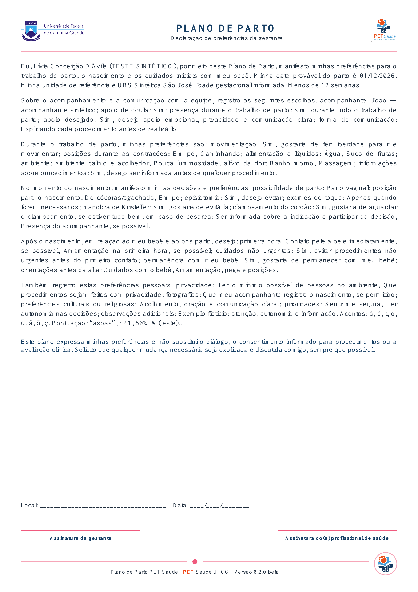
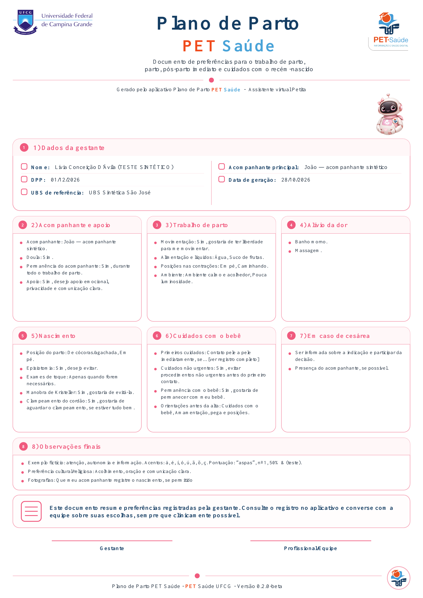
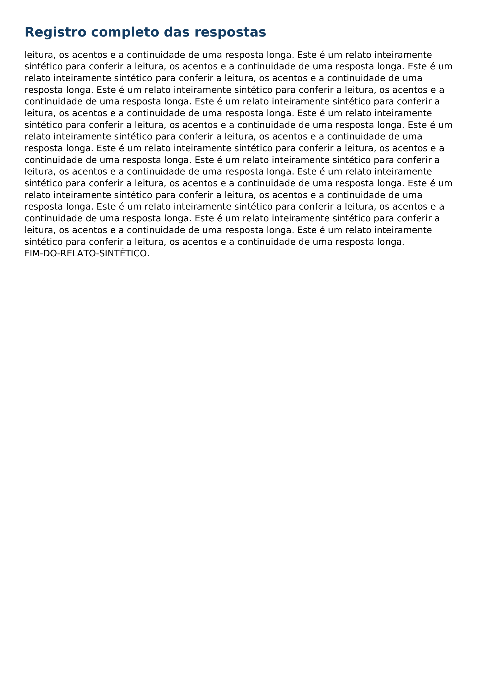

# PDFs sintéticos — tipografia corrigida da PR #5

Todas as 11 páginas renderizadas por Poppler a **240 dpi**, sem navegador. DejaVu Sans Regular/Bold incorporadas. Dados de entrada idênticos aos da comparação anterior.

## Antes e depois

Antes: commit `5b5bd22`, Helvetica substituída pelo leitor e DejaVu apenas como fallback. Depois: uma família incorporada, pesos reais e texto maior. Ambas as versões renderizadas a 240 dpi.

| Documento | Antes | Depois |
| --- | --- | --- |
| Declaração |  |  |
| Resumo visual |  |  |

## declaracao.pdf — 1 página(s)

[Baixar PDF](declaracao.pdf) · [Ver fontes incorporadas](declaracao-fontes.txt)

## resumoVisual.pdf — 4 página(s)

[Baixar PDF](resumoVisual.pdf) · [Ver fontes incorporadas](resumoVisual-fontes.txt)

## resumoVisual-longo.pdf — 6 página(s)

[Baixar PDF](resumoVisual-longo.pdf) · [Ver fontes incorporadas](resumoVisual-longo-fontes.txt)

