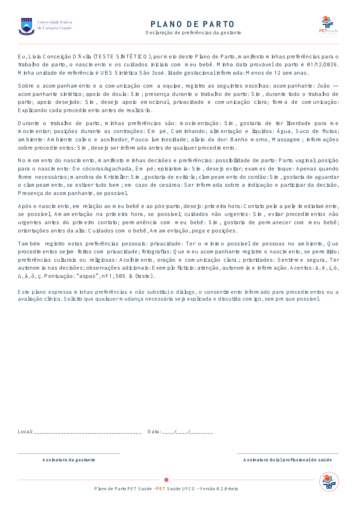
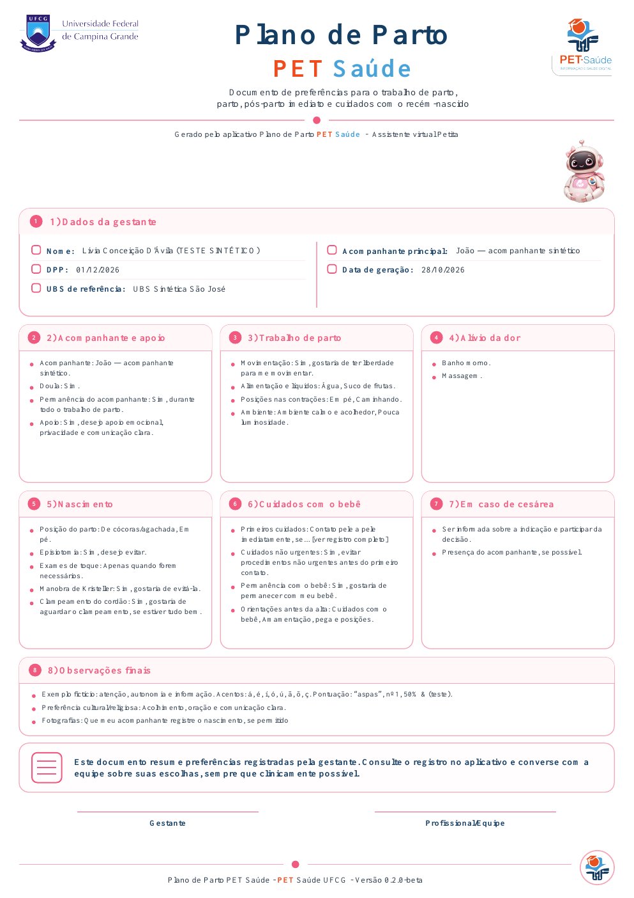
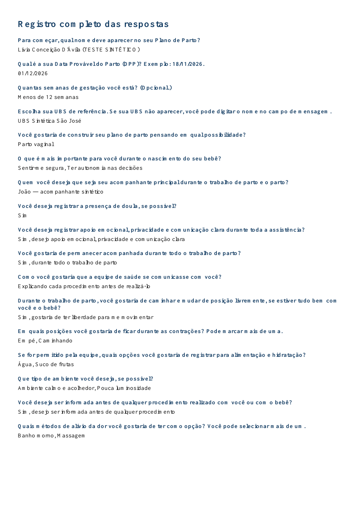
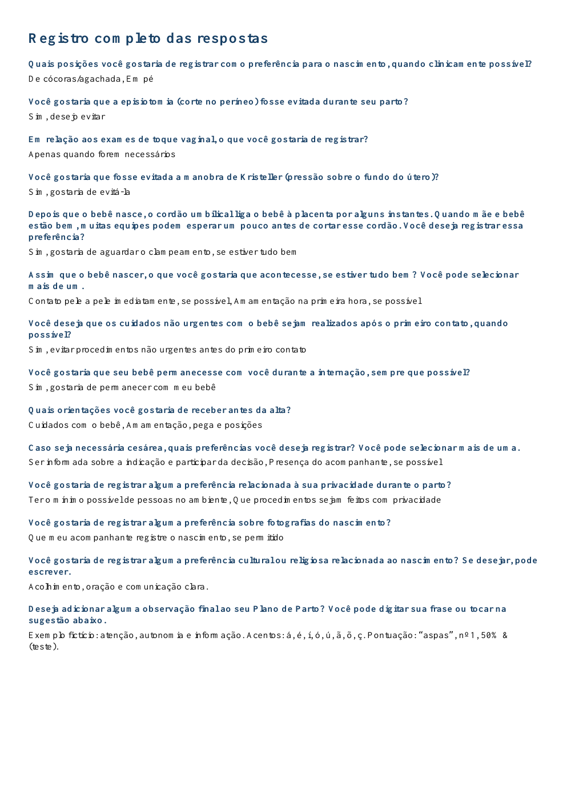
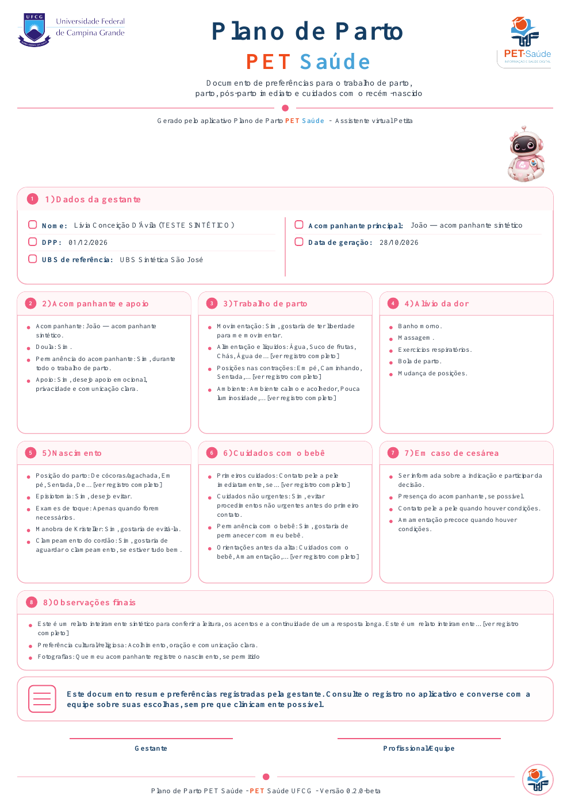
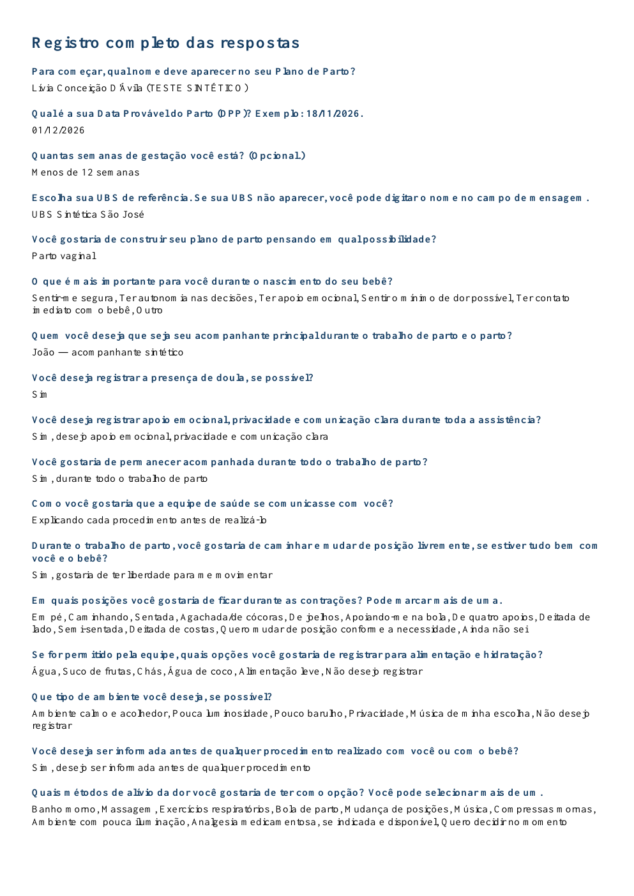
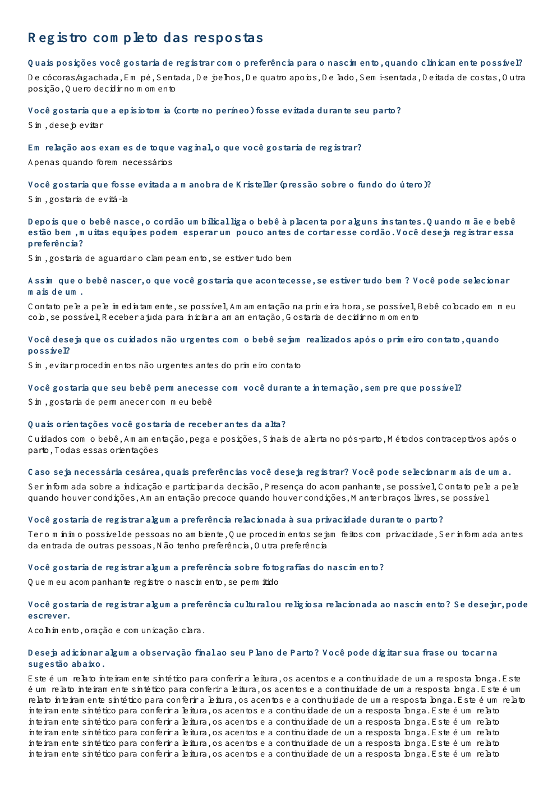
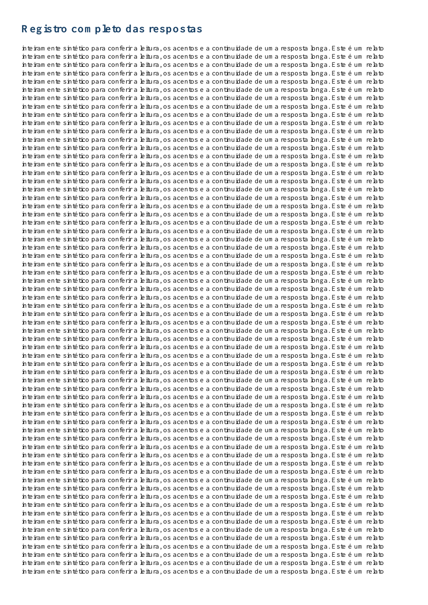
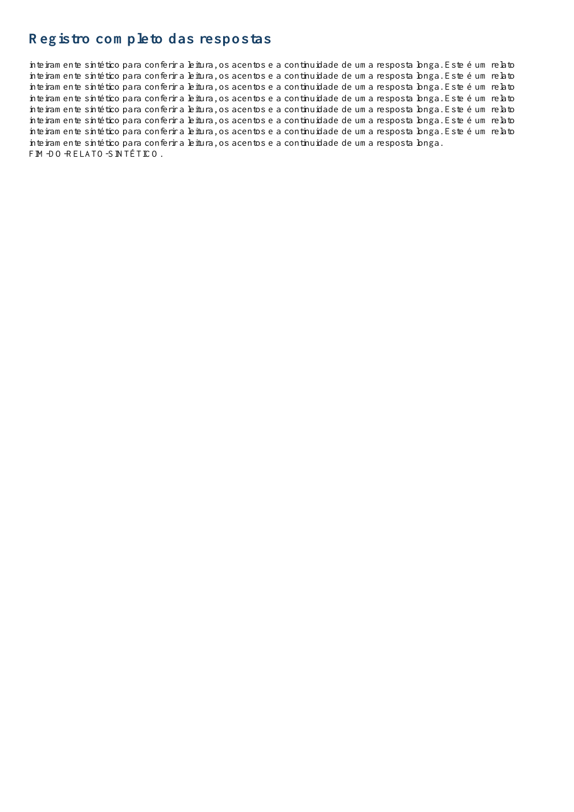

# PDFs sintéticos — galeria completa da PR #5

Renderização por Poppler (`pdftoppm -r 120 -png`), sem navegador. Todos os dados são fictícios. Os PDFs e o manifesto com hashes estão nesta pasta.

## declaracao.pdf — 1 página(s)

[Baixar PDF](declaracao.pdf)

## resumoVisual.pdf — 3 página(s)

[Baixar PDF](resumoVisual.pdf)

## resumoVisual-longo.pdf — 5 página(s)

[Baixar PDF](resumoVisual-longo.pdf)

